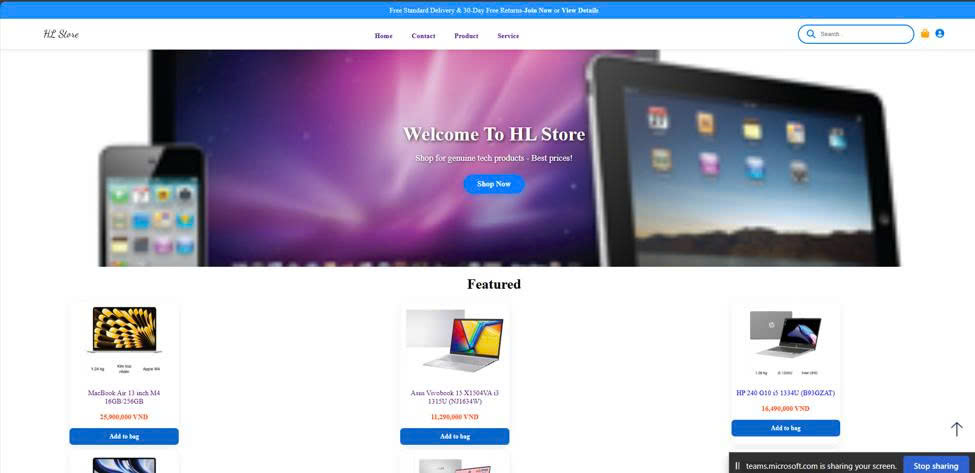
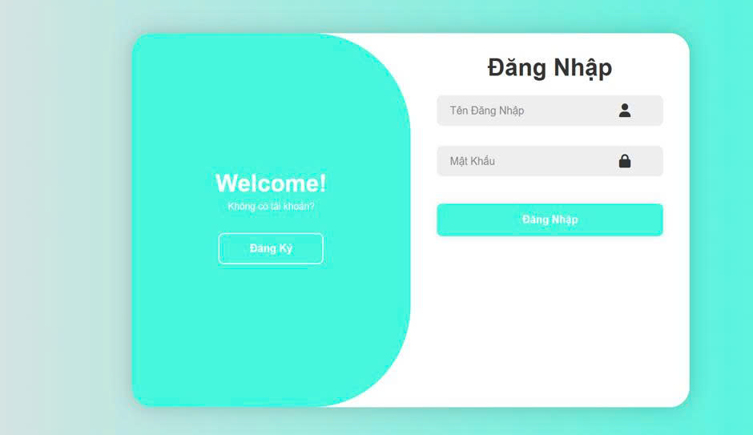
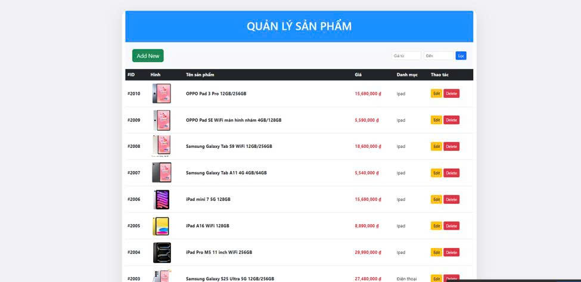
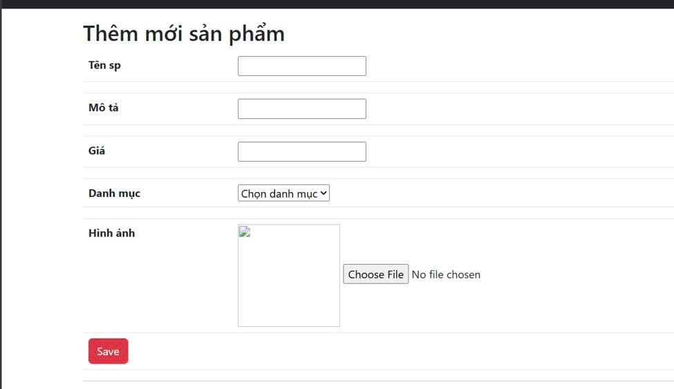
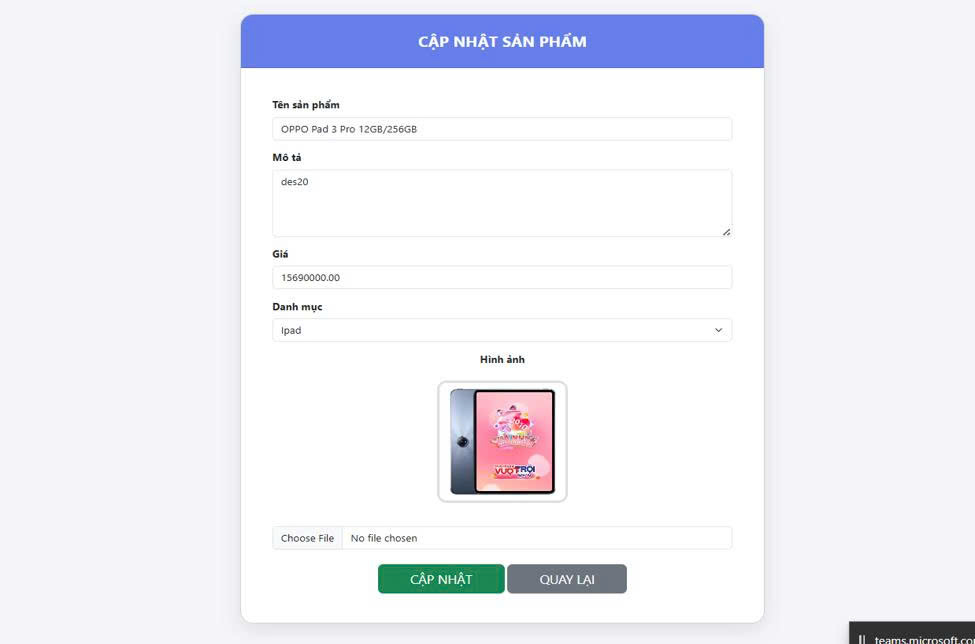
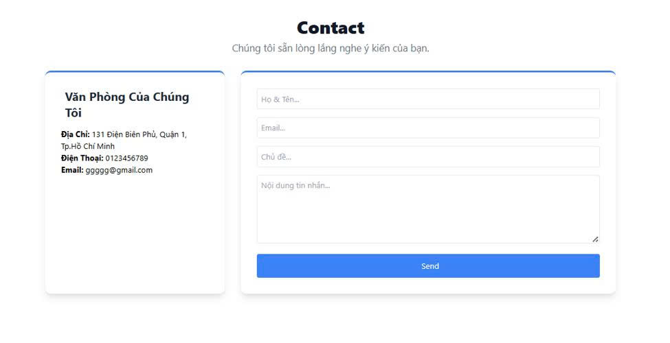

# 🛒 HL Store — Website Bán Hàng Điện Tử

Website thương mại điện tử bán laptop, tablet, điện thoại và phụ kiện công nghệ.  
Được xây dựng bằng **ASP.NET MVC**, hỗ trợ quản lý sản phẩm, đăng nhập/đăng ký và liên hệ.

---

## 📸 Giao diện chính

### 1. Trang chủ (Home)


### 2. Đăng ký


### 3. Đăng nhập


### 4. Quản lý sản phẩm (Admin)


### 5. Thêm mới sản phẩm


### 6. Cập nhật sản phẩm


### 7. Trang Liên hệ (Contact)


---
## 🌟 Tính năng chính

### 👤 Người dùng
- Đăng ký / Đăng nhập tài khoản
- Xem danh sách sản phẩm, sản phẩm nổi bật
- Tìm kiếm sản phẩm
- Thêm sản phẩm vào giỏ hàng
- Gửi liên hệ

### 🛡️ Quản trị viên
- Quản lý sản phẩm (CRUD): Thêm – Sửa – Xóa
- Upload hình ảnh sản phẩm
- Phân loại theo danh mục (iPad, Điện thoại, Laptop…)
- Lọc theo giá

---

## 🛠️ Công nghệ sử dụng

| Thành phần | Công nghệ                        |
|------------|----------------------------------|
| Backend    | ASP.NET MVC (.NET Framework)     |
| Frontend   | HTML, CSS, Bootstrap, JavaScript |
| Database   | SQL Server (Entity Framework)    |
| Project    | HL.store                         |

---

## 📁 Cấu trúc thư mục
sales-website/
├── Controllers/          # Home, Account, Product, Contact...
├── Models/               # Product, Category, User...
├── Views/                # Razor Views
├── Content/              # CSS, hình ảnh tĩnh
├── Hinh/                 # Thư mục lưu hình sản phẩm upload
├── Scripts/              # Thư viện JavaScript
├── App_Start/
├── HL.store.csproj
├── HL.store.sln
├── Web.config
└── README.md


---

## 🚀 Hướng dẫn chạy dự án

### Yêu cầu hệ thống
- Visual Studio 2019 hoặc 2022
- .NET Framework 4.7.2 trở lên
- SQL Server (LocalDB / Express / Full)

### Các bước thực hiện

1. **Clone repository**
   ```bash
   git clone https://github.com/lhluann/sales-website.git
   cd sales-website
   Mở file HL.store.sln bằng Visual Studio
Kiểm tra / cập nhật chuỗi kết nối trong Web.config (nếu cần)
Build solution (Ctrl + Shift + B)
Chạy dự án bằng phím F5
👨‍💻 Tác giả
GitHub: lhluann
Dự án: HL Store – Website bán hàng điện tử
📝 Ghi chú
Hình ảnh sản phẩm được lưu trong thư mục Hinh/
Giao diện hỗ trợ đầy đủ tiếng Việt
Phù hợp làm đồ án / bài tập môn Lập trình Web ASP.NET MVC
